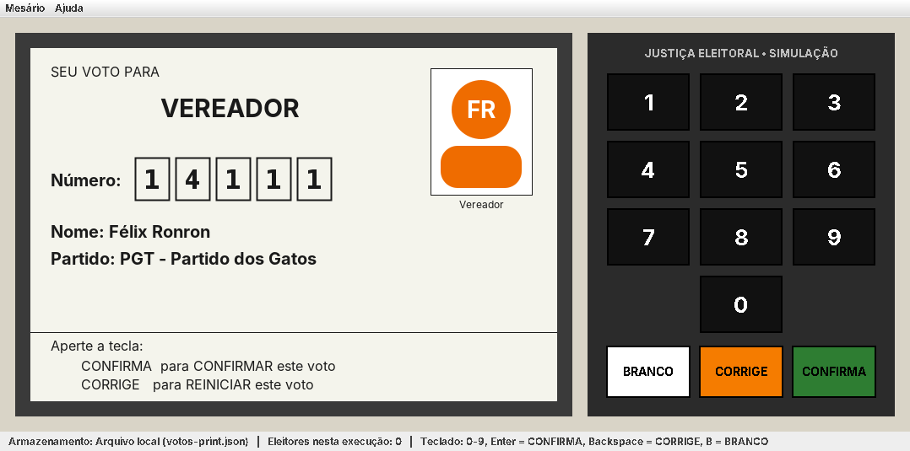
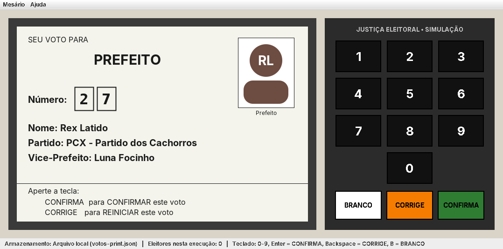
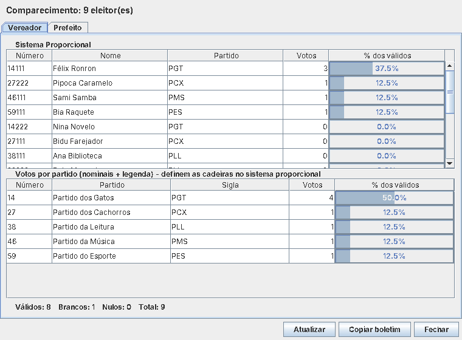

# Urna Cidadã 🗳️

**Simulação educativa do voto eletrônico e combate à desinformação em ano eleitoral**

Projeto de Extensão Curricular – Ciência da Computação – disciplina de Programação Orientada a Objetos (UNIJORGE, 2026.2).

Simulador de urna eletrônica em **Java + Swing**, com persistência em nuvem no **Firebase (Cloud Firestore)**, para oficinas com estudantes do Ensino Médio. A votação é sequencial para dois cargos — **Vereador** (proporcional, 5 dígitos, com voto de legenda) e **Prefeito** (majoritário, 2 dígitos, com vice) — seguindo a lógica da urna real: teclas numéricas, **BRANCO**, **CORRIGE**, **CONFIRMA**, voto nulo, tela **FIM** e o bipe final.

> Todos os partidos e candidatos são **fictícios** (Partido dos Gatos, dos Cachorros, da Leitura, da Música, do Esporte), sem qualquer vínculo com legendas ou pessoas reais. A atividade é apartidária.

| Votando para vereador | Prefeito (com vice) | Apuração do mesário |
|---|---|---|
|  |  |  |

Mais telas em [`docs/imagens`](docs/imagens).

---

## Como executar

Requisitos: **Java 17+** e **Maven 3.8+**.

```bash
mvn package
```

```bash
java -jar target/urna-cidada.jar
```

O `mvn package` também roda os testes automatizados (JUnit 5). Sem nenhuma configuração, a urna funciona **offline** e grava os votos no arquivo `votos-locais.json`.

### Teclas

| Urna | Teclado do computador |
|---|---|
| 0–9 | 0–9 (ou teclado numérico) |
| CONFIRMA | Enter |
| CORRIGE | Backspace / Delete |
| BRANCO | B |

Menu **Mesário** (senha padrão `1234`): *Apuração / Boletim de Urna* e *Zerar urna (nova oficina)*.
Menu **Ajuda**: *Como votar*, lista de candidatos fictícios e *Sobre*.

### Ligando o Firebase (Cloud Firestore)

1. Crie um projeto em <https://console.firebase.google.com> e ative o **Cloud Firestore**.
2. Em *Configurações do projeto → Contas de serviço*, clique em **Gerar nova chave privada** e salve o JSON como `firebase-credenciais.json` na pasta do programa (**não faça commit desse arquivo** — já está no `.gitignore`).
3. Copie `urna.properties.exemplo` para `urna.properties` e descomente `firebase.credenciais=firebase-credenciais.json`.
   (Alternativa: variável de ambiente `GOOGLE_APPLICATION_CREDENTIALS`.)
4. Rode o programa. A barra de status mostra `Armazenamento: Firebase (Cloud Firestore) + reserva local`.

Se a internet da escola cair durante a oficina, o voto é gravado no arquivo local e um aviso aparece na barra de status; a apuração soma os votos da nuvem e da reserva.

### Trocando a eleição

Os cargos, partidos e candidatos ficam em [`src/main/resources/eleicao-padrao.json`](src/main/resources/eleicao-padrao.json). Para usar outra lista sem recompilar, crie um JSON no mesmo formato e aponte `eleicao.arquivo` no `urna.properties`. O programa valida a quantidade de dígitos e se o número do candidato começa pelo número do partido.

---

## Regras da urna implementadas

| Situação | Resultado |
|---|---|
| Número de candidato existente + CONFIRMA | Voto **nominal** |
| Vereador: só os 2 dígitos do partido + CONFIRMA | Voto de **legenda** |
| Vereador: número completo inexistente, partido existente | Voto de **legenda** |
| Número sem candidato (e, no proporcional, sem partido) | Voto **nulo** |
| BRANCO antes de digitar qualquer número | Voto em **branco** (com número digitado, a tecla é ignorada — use CORRIGE) |
| CONFIRMA com número incompleto | Ignorado (bipe de erro) |

Brancos e nulos **não** são votos válidos. Na apuração do cargo proporcional também aparecem os votos por partido (nominais + legenda), que são os que definem as cadeiras.

**Sigilo do voto:** cada voto é gravado como um documento anônimo `{cargo, tipo, numero}` — sem identificação do eleitor, sem horário e sem ordem (o arquivo local é embaralhado a cada gravação), como no Registro Digital do Voto da urna real.

---

## Arquitetura (POO)

```
br.com.urnacidada
├── Aplicacao                  ponto de entrada; escolhe o repositório (nuvem / local)
├── modelo                     domínio
│   ├── Cargo (abstrata) ─┬─ CargoProporcional   (permite legenda)
│   │                     └─ CargoMajoritario    (2 dígitos, sem legenda)
│   ├── Candidato (abstrata) ─┬─ CandidatoProporcional
│   │                         └─ CandidatoMajoritario (com vice)
│   ├── Voto (abstrata) ─┬─ VotoNominal ─ VotoLegenda ─ VotoBranco ─ VotoNulo
│   ├── Partido, Eleicao, TipoVoto, RegistroVoto (record)
├── servico                    regras de negócio, sem Swing (testáveis)
│   ├── SessaoVotacao          máquina de estados de um eleitor (teclas da urna)
│   ├── ServicoUrna            fachada usada pela interface
│   └── Apuracao, ResultadoCargo
├── persistencia
│   ├── VotoRepository (interface)
│   ├── FirestoreVotoRepository   Cloud Firestore (gravação em lote atômico)
│   ├── ArquivoJsonVotoRepository arquivo local (gravação atômica)
│   ├── MemoriaVotoRepository     testes
│   └── VotoRepositoryComReserva  Decorator: nuvem com reserva local
├── config                     Configuracao (urna.properties / env), CarregadorEleicao (JSON)
└── ui                         JanelaUrna, PainelTela, PainelTeclado, DialogoApuracao, Som
```

Onde estão os pilares da POO:

- **Abstração:** `Cargo`, `Candidato` e `Voto` são abstratas; `VotoRepository` é uma interface.
- **Herança:** cargos, candidatos e votos especializados herdam das classes-base.
- **Polimorfismo:** `cargo.permiteVotoLegenda()`, `candidato.getInformacoesAdicionais()` (o majoritário mostra o vice), `voto.getTipo()` / `getMensagemTela()`; a urna usa qualquer `VotoRepository` sem saber qual é.
- **Encapsulamento:** atributos `private final`, validações nos construtores (dígitos, prefixo do partido), listas devolvidas como imutáveis; a sessão só muda de estado pelas "teclas".

Diagramas de classes, casos de uso e o modelo de dados do Firestore: [`docs/modelagem.md`](docs/modelagem.md).

---

## Documentação da extensão

| Documento | Conteúdo |
|---|---|
| [`docs/modelagem.md`](docs/modelagem.md) | Casos de uso, diagrama de classes, modelo de dados do Firestore |
| [`docs/desafio1-cronograma.md`](docs/desafio1-cronograma.md) | **Desafio 1** – Cronograma de atividades (modelo UNIJORGE) |
| [`docs/desafio2-ods.md`](docs/desafio2-ods.md) | **Desafio 2** – Memorial de correlação com os ODS 16 e 4 |
| [`docs/desafio3-relatorio-final.md`](docs/desafio3-relatorio-final.md) | **Desafio 3** – Modelo do Relatório Final (preencher após a oficina) |
| [`docs/material-educativo.md`](docs/material-educativo.md) | Cartilha: fake news, deepfakes e como funciona a urna |
| [`docs/roteiro-oficina.md`](docs/roteiro-oficina.md) | Roteiro da oficina na escola |
| [`docs/questionario.md`](docs/questionario.md) | Questionário de percepção (antes e depois da oficina) |

## Referências

- BRASIL. Tribunal Superior Eleitoral. *Simulador de votação*. <https://www.tse.jus.br/hotsites/simulador-de-votacao/>
- GOOGLE. *Documentação oficial do Firebase*. <https://firebase.google.com/docs>
- ORACLE. *Java SE – API Swing*. <https://docs.oracle.com/javase/>
- NAÇÕES UNIDAS NO BRASIL. *ODS 16* e *ODS 4*. <https://brasil.un.org/pt-br/sdgs>
