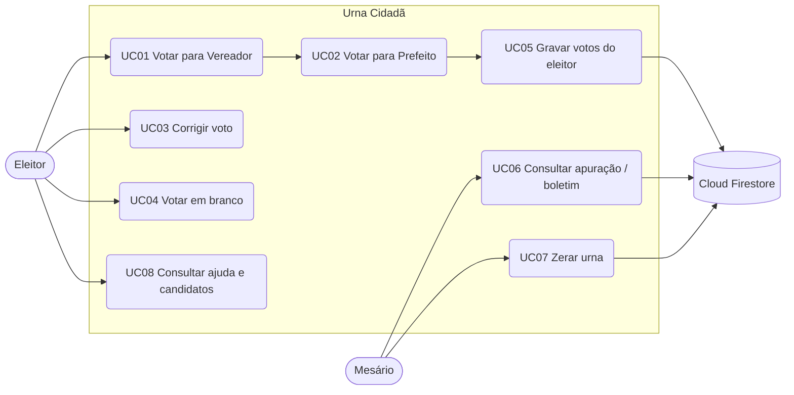
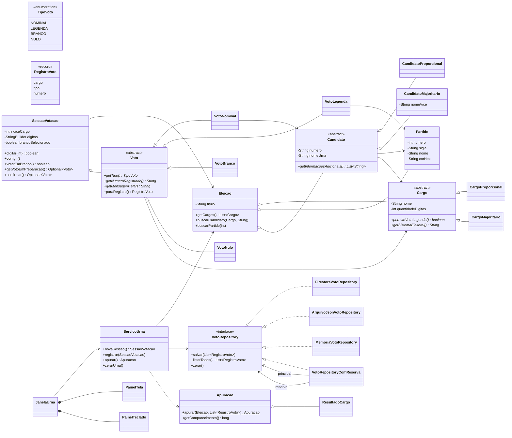

# Especificação e modelagem do sistema

Etapa 2 do projeto (item 4.1): casos de uso, modelagem das classes e modelagem dos dados no Firebase.

## 1. Atores

| Ator | Descrição |
|---|---|
| **Eleitor** | Estudante convidado da oficina que vota na urna. |
| **Mesário** | Discente do grupo que conduz a oficina: libera a urna, acompanha a apuração e zera a urna entre turmas. |
| **Firebase** | Sistema externo (Cloud Firestore) que armazena os votos. |

## 2. Casos de uso



### UC01/UC02 – Votar (fluxo principal)

1. A urna mostra "SEU VOTO PARA" e o cargo atual (Vereador, depois Prefeito).
2. O eleitor digita o número. A cada tecla, a urna bipa e preenche uma casa.
3. Ao completar o número, a urna exibe nome, partido, vice (majoritário) e a "foto" do candidato.
4. O eleitor aperta **CONFIRMA**; a urna bipa e passa ao próximo cargo.
5. Após o último cargo, a urna grava os votos (UC05), exibe **FIM** e toca o bipe final.
6. Depois de alguns segundos, a urna fica pronta para o próximo eleitor.

**Fluxos alternativos**

- *3a. Vereador – só o número do partido (2 dígitos):* a tela mostra o partido e "VOTO DE LEGENDA".
- *3b. Vereador – candidato inexistente de partido existente:* "CANDIDATO INEXISTENTE – VOTO DE LEGENDA".
- *3c. Número sem candidato (ou sem partido no proporcional):* "NÚMERO ERRADO – VOTO NULO".
- *4a. CONFIRMA com número incompleto:* tecla ignorada, bipe de erro.
- *UC03 – CORRIGE:* limpa o número (ou o branco) do cargo atual.
- *UC04 – BRANCO:* só funciona antes de digitar números; mostra "VOTO EM BRANCO".
- *5a. Falha na nuvem:* os votos vão para o arquivo local de reserva e um aviso aparece na barra de status.

### UC06 – Apuração

Pré-condição: senha do mesário. Lê todos os votos (nuvem + reserva) e mostra, por cargo: votos de cada candidato, votos de legenda, votos por partido (proporcional), percentuais sobre válidos, brancos, nulos e total. Permite copiar o boletim em texto.

### UC07 – Zerar urna

Pré-condição: senha + confirmação. Apaga todos os votos da coleção do Firestore e do arquivo local.

## 3. Diagrama de classes



Padrões usados: **Repository** (isola a persistência), **Decorator** (`VotoRepositoryComReserva`), **Facade** (`ServicoUrna`), **Observer** (o teclado avisa a janela pela interface `PainelTeclado.Ouvinte`).

## 4. Modelo de dados no Cloud Firestore

Coleção única, configurável (padrão `votos`). Um documento por voto, com ID aleatório gerado pelo Firestore:

```
votos/                                 (coleção)
 ├── 3fK9a1...  { cargo: "Vereador", tipo: "NOMINAL", numero: "14111" }
 ├── Q8zLm2...  { cargo: "Prefeito", tipo: "NOMINAL", numero: "27" }
 ├── aP02xR...  { cargo: "Vereador", tipo: "LEGENDA", numero: "38" }
 ├── Zt7yW4...  { cargo: "Prefeito", tipo: "BRANCO",  numero: "" }
 └── ...
```

| Campo | Tipo | Valores |
|---|---|---|
| `cargo` | string | nome do cargo (`Vereador`, `Prefeito`) |
| `tipo` | string | `NOMINAL`, `LEGENDA`, `BRANCO`, `NULO` |
| `numero` | string | número do candidato (nominal), do partido (legenda) ou vazio |

Decisões:

- **Sigilo:** nenhum campo identifica o eleitor; não há data/hora nem contador sequencial. Os votos de um mesmo eleitor ficam em documentos separados, sem ligação entre si.
- **Atomicidade:** os votos de um eleitor são gravados num `WriteBatch` — ou todos entram, ou nenhum.
- **Cadastro da eleição fora do banco:** partidos e candidatos ficam no JSON de configuração; o banco guarda só votos. Isso simplifica as regras de segurança e permite trocar os candidatos fictícios sem migração.
- **Segurança:** a urna usa o Admin SDK (conta de serviço), que ignora as regras do Firestore. Recomenda-se bloquear o acesso de clientes:

```
rules_version = '2';
service cloud.firestore {
  match /databases/{database}/documents {
    match /{document=**} {
      allow read, write: if false;
    }
  }
}
```
